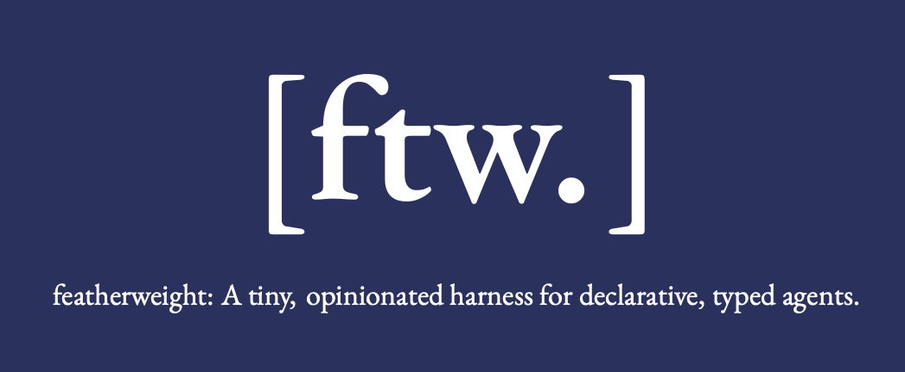

<p align="center">
  
</p>

# featherweight [ftw.]

[](https://pypi.org/project/featherweight/)
[](https://pypi.org/project/featherweight/)
[](https://github.com/aadhithya/featherweight/blob/main/LICENSE)
[](https://github.com/aadhithya/featherweight/actions/workflows/test.yml)

**An opinionated agent harness. Pydantic is the spec. Everything else follows.**

An agent is a typed class. Its input, output, tools, skills and subagents are declared right there and enforced, not hoped for.
The boilerplate every agent project ends up writing (retries, limits, failures, tracing, delegation, workers, resume) is already
written. You write the pipeline. That's the part that's yours.

A malformed agent never reaches the model. A running one has a known input and a known output. No guessing.

It has opinions. Take them, or fork off.

And there's a skill, so your coding agent can build with it from the first prompt.

> Designed by a human. Implemented by Claude.
>
> **Alpha.** The API can still change before 1.0.

## Built on LangChain, on purpose

featherweight doesn't replace LangChain. It sits on it.

- **Your tools are LangChain tools.** Write one with `@tool`, or take one from the LangChain ecosystem.
- **MCP goes through LangChain's MCP adapters.** Stdio or HTTP servers, declared on the agent.
- **Models are LangChain chat models underneath**, behind settings classes that are checked when the agent is built.

So what LangChain already gives you, a pile of integrations and adapters, can plug into agents that are typed, bounded and run on workers.
We test the providers and tools featherweight ships with. Other LangChain integrations go into the same slots, but we haven't verified them one by one.

## What you get

| | |
|---|---|
| **Typed, declared, enforced** | An agent is a class. What goes in and what comes out is a schema. A bad declaration fails when it is written, a bad answer is caught and retried before your code ever sees it. |
| **Least privilege** | Everything is an allow-list. A capability an agent has is one the developer gave it, on purpose. |
| **Plain Python, failures as values** | Order, loops and branching are `if` and `for`: no graph, no workflow engine. A failed run hands you the error and a status, not an exception. |
| **Agents that delegate** | Subagents on a leash, only the ones allowed, only so deep. Or background agents: one starts another and goes on, and the result comes back when it is ready. |
| **Resume instead of rerun** | A pipeline that dies halfway picks up where it stopped, without paying for the steps that worked. |
| **Workers, and a lost worker is fine** | Submit a job from your API, run it on workers, follow it live, cancel it. Lose a worker mid-job and another takes over. |
| **Streams to your UI** | Chat answers and job status stream over standard protocols (AG-UI, the Vercel AI SDK, SSE), so a browser can listen as is. |
| **See what it did** | OpenTelemetry traces of jobs, attempts, model calls and tool calls, in the format observability and evaluation platforms already read. Content stays off unless you turn it on. |
| **Any model, any tool** | Gemini, Gemma, Claude, OpenAI or your own. MCP servers and skills plug in and stay out of the context until needed. |
| **Your data, your storage** | The framework stores metadata and nothing else. Databases, result stores, queues and observers are interfaces: implement one, run the kit that checks it. `SqliteDatabase` for local work and `PostgresDatabase` for deployment both ship, to get you going. |

## What you don't get

| | |
|---|---|
| **A workflow engine** | No graph to draw, no nodes and edges. Order is `if` and `for`, and you already know those. |
| **A server or a UI** | We stream, you serve. Bring your own API and frontend: it speaks AG-UI, the Vercel AI SDK and SSE. |
| **Your data** | No stored conversations, no stored outputs. Metadata only. What happens to the rest is your call, and your problem. |
| **An evaluation platform** | We don't score anything. We emit traces your platform already reads, and it does the judging. |
| **A way around the rules** | An agent that doesn't declare itself properly doesn't run. These are opinions. Take them, or fork off. |

Want durable execution or built-in evals? Pydantic AI. Want a graph that pauses and resumes? LangGraph. Want typed, bounded agents on
workers, in plain Python? Here.

## Built for agentic coding

There is a skill. Plug it into your favourite coding agent and it already knows how to build with featherweight: the typed agent, the rules,
the patterns, and the whole book. You start building in your editor, not in a docs tab.

In Claude Code:

```
/plugin marketplace add aadhithya/featherweight
/plugin install featherweight@featherweight
```

OpenAI Codex, Cursor, GitHub Copilot, Gemini CLI and the other tools that read Agent Skills: install it with the [`skills`](https://github.com/vercel-labs/skills) CLI,
which puts it where each tool looks (it needs Node.js).

```
npx skills add aadhithya/featherweight                 # asks which tools to install it for
npx skills add aadhithya/featherweight -a codex        # or name one: codex, cursor, claude-code, ...
```

Or copy [`skills/featherweight`](https://github.com/aadhithya/featherweight/blob/main/skills/featherweight) into the tool's skills folder yourself. There is also an
[`AGENTS.md`](https://github.com/aadhithya/featherweight/blob/main/AGENTS.md) at the root, for the tools that read that.

## Getting started

The quickest way in is [the book](https://github.com/aadhithya/featherweight/blob/main/docs/book/README.md): a tiny incident report
assistant that grows from a first agent to workers, chapter by chapter, with code that runs in a container.

```
pip install featherweight
pip install 'featherweight[all]'    # or just: mcp, anthropic, openai, postgres, otel
```

Python 3.12 or later. Import what you use: `from featherweight import AgentBase, AgentRunner`. (`import featherweight as ftw` works too, as a joke.)

## Showcase: fw-concierge

> ### [fw-concierge](https://github.com/aadhithya/fw-concierge) ✨
> *A concierge that books a physio appointment, end to end, built on featherweight.*
>
> A chat assistant finds an appointment in Munich. A background worker researches providers while you keep chatting.
> Nothing is booked until you say yes. One command runs the whole thing.

## Read more

- [**The book**](https://github.com/aadhithya/featherweight/blob/main/docs/book/README.md): build something step by step, from a first agent to workers
- [**A production stack**](https://github.com/aadhithya/featherweight/blob/main/docs/production-stack.md): what to use where, with Postgres, your queue and your result store
- [**The guides**](https://github.com/aadhithya/featherweight/blob/main/docs/README.md), [**the specs**](https://github.com/aadhithya/featherweight/blob/main/docs/specs/README.md) (what each part does, and why) and [**the examples**](https://github.com/aadhithya/featherweight/blob/main/examples/README.md)
- [**Development**](https://github.com/aadhithya/featherweight/blob/main/docs/development.md) and the [**changelog**](https://github.com/aadhithya/featherweight/blob/main/CHANGELOG.md)

## License

Apache License 2.0. See [LICENSE](https://github.com/aadhithya/featherweight/blob/main/LICENSE).
