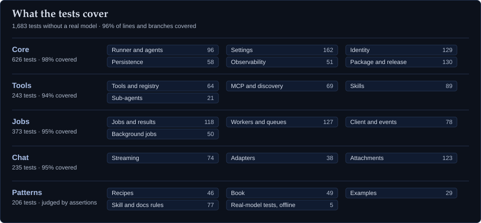

# Testing

How featherweight is tested, and the rules a change follows. This page owns these rules.

`make coverage` draws this map from the tests themselves, so it is not edited by hand.

 
 

## Commands

| Command | Runs |
|---|---|
| `make test-core` | Runner, agents, settings, identity, persistence, observability, package |
| `make test-tools` | Tools, MCP, discovery, skills, sub-agents |
| `make test-jobs` | Jobs, resume, results, workers, queues, background jobs |
| `make test-chat` | Streaming, adapters, attachments |
| `make test-patterns` | Recipes, book, examples, the skill and the docs rules |
| `make test` | Everything without a real model |
| `make coverage` | The same with coverage, the gate, the badges and the map |
| `make e2e` | Real models. It costs money, and is run by hand |

All but `make e2e` run with every API key and token blanked. `ARGS` is passed to pytest.

## The coverage gate

Decided on 2026-11-26.

- **95% overall, and 90% for each suite** that has source (core, tools, jobs, chat). Lines and branches count together.
- **Measured on one run of all the tests,** grouped by source file ([`scripts/test_report.py`](scripts/test_report.py)). A suite
  run alone would not count what the tests of another suite run.
- **The patterns have no percentage.** They have no source of their own: what counts is what their tests assert.
- **It runs on every pull request, and in the commit hook** (`make hooks`). In CI it is part of the `test` check, which
  `main` requires, so a pull request cannot be merged until it passes. It runs again for each new push to the pull request,
  and not for a push to `main`. It also fails when the badges or the map are out of date. No key is given to it, and the
  real-model tests are never run there. (Decided on 2026-11-26.)
- **The badges are files in the repository.** `make coverage` rewrites them and the map when they are out of date, and the hook
  then fails once: add the files and commit again. A badge is red under 90%, and goes from near red at 90% to green at 100%.
  The map has the colours of the documentation site's dark theme.
- Code that only runs in a subprocess (the takeover test, some examples) is not counted.

Coverage says that a line ran, not that a test checked what it did. The rules below are for that.

## What a test must check

- **No real model.** A fake model stands in ([how](docs/recipes/testing-with-a-fake-model.md)). Everything else may be real:
  sqlite, Postgres, an MCP server in a subprocess, a worker process.
- **Check what the model was given,** not what the fake was told to answer. A fake follows its script whatever it is offered, so
  asserting its final answer proves little. Assert the input, the tool results and the history that it saw.
- **Check the promise of the page.** If a page says that content is not traced, that the history is kept or that a finished step is
  not paid for again, a test fails when that stops being true. Check what is refused as well as what works.
- **A new test should fail without the thing it tests.** Break it once and see.
- **Every recipe, every chapter folder with code, and every example is run.** Tests fail when a recipe or a chapter folder has
  none. That check sees that the code is run or read by its test, not what the test asserts.
- **A new test file goes into a suite,** and a new module into the coverage of one (`scripts/test_report.py`). A test fails
  until it does.

## Real models

`make e2e` has four tests, all on Gemini: MCP tools bound and found by search, a skill, and a sub-agent. Nothing runs on
Claude or OpenAI, and streaming, attachments, jobs and resume have no real-model test.

Proposed, not decided: a few more scenarios for what depends on the provider (structured output with tools, streaming,
attachments, thinking), on small models, run by hand before a release. Not one for each recipe.

## Audit of the pattern tests, 2026-11-26

The tests of the recipes, the book and the examples were read, and recipes were broken on purpose in a copy of the repository
to see whether their tests noticed (`doclearn` was left out).

- **Before:** 5 recipes had weak tests and 6 partial ones. Six deliberate breaks went unnoticed. Only 3 of the book's chapter
  folders were run, and the examples for skills, launching and MCP were only built.
- **After:** the 11 recipe tests were strengthened, and they caught all of 14 deliberate breaks. The breaks were chosen knowing
  the tests, so this shows that those gaps are closed, not that nothing can pass. Every chapter folder and every example (but
  `doclearn`) is run.
- **Found and fixed:** the session of [chapter 5-3](docs/book/code/5-3/app.py) and of
  [`examples/background`](examples/background/session.py) started a new turn for a background result that the running turn had
  already been given, so the model was told twice. Both now check the history first, as
  [the finished project](docs/book/code/project/chat.py) does.
