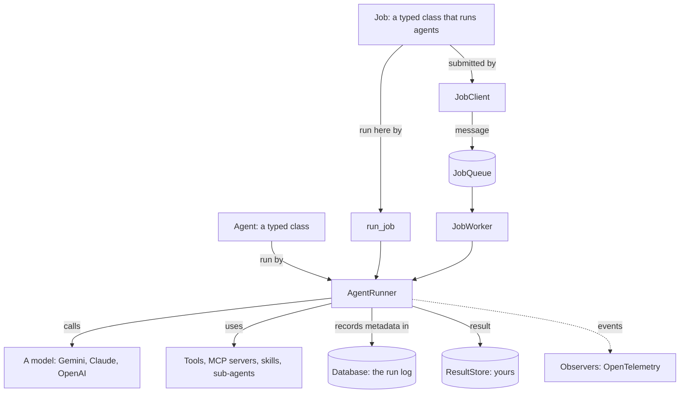

<!-- nav:top -->
[Book](../README.md) › [Part 0: Start here](../README.md#part-0-start-here) › The map
<!-- /nav:top -->

# The map

How the parts fit. Each box is a chapter, or a few.

- **An agent** is a typed class. **The runner** runs it, against a model, with its abilities, and records metadata about every attempt
  in **the database**, the run log.
- **A job** is a typed class that runs agents. `run_job` runs it in your process. A client submits it to **a queue**, and **a worker**
  runs it elsewhere. The same job, the same record, in both places.
- **Results** go to **a result store that you own**. The framework keeps no data.
- **Observers** receive what happens, and send it where you want: OpenTelemetry is the one we ship.

## I want to...

| I want to | Go to |
|---|---|
| Write an agent whose output I can trust | [A typed agent](../01-your-first-agent/02-a-typed-agent.md), [Failures and check_output](../01-your-first-agent/05-failures-and-check-output.md) |
| Give it tools, MCP servers or skills | [Tools](../02-abilities/01-tools.md), [MCP](../02-abilities/02-mcp.md), [Skills](../02-abilities/03-skills.md) |
| Run it over many inputs, and recover from a failure | [What a job is](../03-jobs-and-pipelines/01-what-a-job-is.md), [Resume](../03-jobs-and-pipelines/04-resume.md) |
| Build a chat | [A streaming agent](../04-chat/01-a-streaming-agent.md), [In the browser](../04-chat/02-in-the-browser.md) |
| Run it somewhere else, on several workers | [Submit and a worker](../05-in-production/01-submit-and-a-worker.md), [Several workers](../05-in-production/02-several-workers.md) |
| Let an agent start another and go on | [Background agents](../05-in-production/03-background-agents.md) |
| See what it did | [What happened](../01-your-first-agent/04-what-happened.md), [Observability](../05-in-production/04-observability.md) |
| Use my own database, queue or store | [Bring your own storage](../06-bring-your-own-storage/01-postgres.md) |
| Look up an exact rule | [The guides](../07-reference/01-the-guides.md), [the specs](../07-reference/02-the-specs.md) |

<!-- nav:bottom -->
---

[← What featherweight is](01-what-it-is.md) · [Part 0: Start here](../README.md#part-0-start-here) · [The philosophy →](03-philosophy.md)
<!-- /nav:bottom -->
