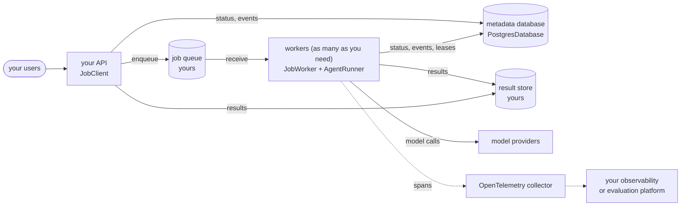

# A production stack

featherweight is the harness. The infrastructure is yours. This page is one coherent, production-shaped way to put the pieces together,
and what to reach for in each place.

> **This is a suggestion, and one way of many.** Every component here can be swapped for whatever you want or already run, and your own
> stack always wins over this page. featherweight requires none of these choices: it asks only that what you plug in implements its interface
> (a `Database`, a `JobQueue`, a `ResultStore`, an `Observer`). Use Redis where it says Postgres, keep results in object storage, run workers on a
> platform of your choice: it is all your call.



## What to use where

| Piece | What featherweight ships | A good choice (swap it freely) |
|---|---|---|
| **Metadata database** (jobs, events, the run log, leases) | `SqliteDatabase` and `PostgresDatabase` | **Postgres**, in anything that is not a toy. The API and every worker point at the same one. sqlite is for local work: one machine, one file. |
| **Job queue** | `SqliteQueue` (one machine) and `MemoryQueue` (tests) | **Implement `JobQueue`** over what your environment already runs. Good choices: Postgres (a table with `SELECT ... FOR UPDATE SKIP LOCKED`, and `LISTEN/NOTIFY` to wake a worker), Redis streams, or a cloud queue (SQS, Pub/Sub). We do not ship these: they are thin and specific to where you run. The interface asks for a lease, `extend` and a delivery count, which these already have: see [your own queue](submitted-jobs.md#your-own-queue). |
| **Result store** | `SqliteResultStore` | **You own the schema.** Keep only what you need for resume, audit and your product. A table in Postgres is the usual start. For large outputs, keep the output in object storage (S3, GCS) and store a reference. See [persistence](persistence.md). |
| **The API** | none: featherweight runs no server | Your web framework (FastAPI, for example). It submits with `JobClient` and streams a job's events to the browser over SSE (`sse.encode`). |
| **Workers** | `JobWorker` | The same image as the API, a different command. Run as many as you need: a worker that dies loses its lease and another takes the job over. Give long jobs a `timeout`. |
| **Observability** | `OTelObserver` | Send spans to an OpenTelemetry collector, and from there to the backend or evaluation platform you already use. Content stays off unless you turn it on. See [observability](observability.md). |
| **Models** | Gemini, Gemma, Claude, OpenAI, or your own provider class | Provider keys from your secrets manager, as environment variables. |

## The wiring

A sketch. `MyQueue` and `MyResultStore` are the two classes you write.

```python
import os

from featherweight import AgentRunner, JobClient, JobWorker, OTelObserver, PostgresDatabase

# the same in every process
queue = MyQueue(...)  # your JobQueue
results = MyResultStore(...)  # your ResultStore

# the API process
async with PostgresDatabase(os.environ["DATABASE_URL"]) as db:
    client = JobClient(db, queue, results, observers=[OTelObserver()])
    job_id = await client.submit(summarise, Report(text=text))  # then follow it: client.events(job_id)

# a worker process
async with PostgresDatabase(os.environ["DATABASE_URL"]) as db:
    runner = AgentRunner(db, results=results, observers=[OTelObserver()])
    await JobWorker(db, queue, runner, jobs=[summarise], results=results).run()
```

## Before you rely on it

- **Check what you wrote.** Each piece you implement has a conformance kit in `featherweight.testing`: `check_queue`, `check_result_store`
  (and `check_database` and `check_observer`). Run them in your own tests.
- **A job must be safe to run twice.** A queue delivers at least once, and a worker can be lost mid-job: see
  [several workers](submitted-jobs.md#several-workers).
- **Where your data lives is your decision.** featherweight stores metadata and nothing else: status, tokens, timing, hashes. Inputs, outputs
  and results are in the queue and the result store you chose, under your own retention and access rules.

To see the same shape run on one machine, the finished project of [the book](book/README.md) submits jobs to two workers over a sqlite queue.
